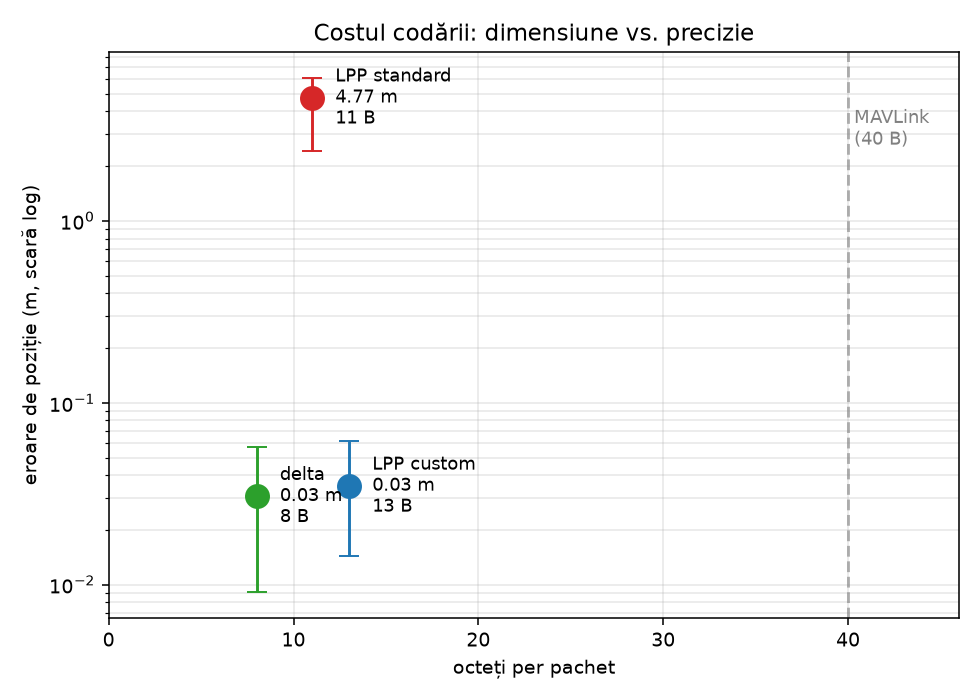
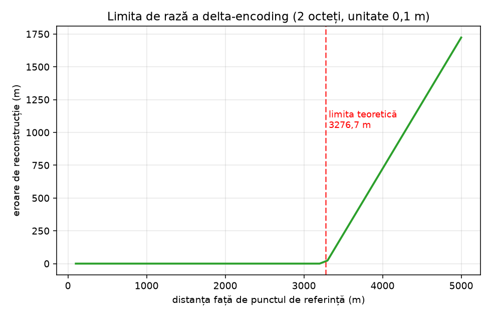
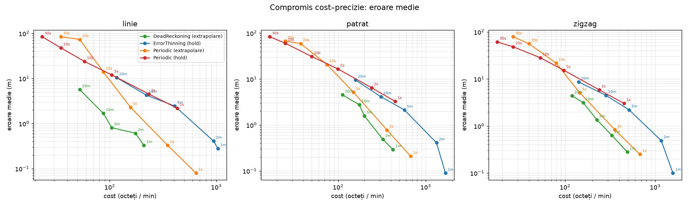
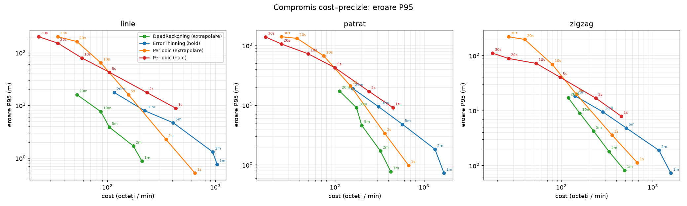

# MAVLite — telemetrie MAVLink comprimată pe canale LoRa

Pipeline și studiu experimental pentru transmiterea telemetriei UAV
(MAVLink) printr-un canal LoRa point-to-multipoint, folosind codare
Cayenne LPP.

## Problema

O dronă produce telemetrie MAVLink cu zeci de mesaje pe secundă. Un canal
LoRa permite zeci de octeți la câteva secunde, sub restricția de duty cycle
de 1% (EU868). Întrebarea este ce se pierde când reduci fluxul și cât costă
fiecare compromis.

Întrebarea de cercetare:

> Pentru telemetria MAVLink transportată prin Cayenne LPP pe un canal LoRa
> P2MP cu duty cycle, care combinație de codare, strategie de reducere și
> nivel de autentificare menține eroarea de poziție sub un prag dat pentru
> cât mai multe drone?

## Contribuții

1. Cuantificarea costului de reprezentare: MAVLink vs. Cayenne LPP
   (standard, custom, delta), în octeți și eroare de cuantizare.
2. Evaluarea strategiilor de reducere pe traiectorii reale de UAV,
   cu eroare de poziție și Age of Information ca metrici.
3. Costul securității în bugetul de transmisie: octeți, airtime,
   număr de drone servite. *(planificat)*
4. Pipeline reproductibil, cu date și cod.

---

## Instalare

Mediul de dezvoltare presupune Linux (testat pe Ubuntu 24.04 prin WSL2).

```bash
sudo apt install -y git python3 python3-pip python3-venv build-essential

python3 -m venv .venv
source .venv/bin/activate
pip install -r requirements.txt
```

Pentru generarea datelor e nevoie de ArduPilot SITL:

```bash
git clone --recurse-submodules https://github.com/ArduPilot/ardupilot.git
cd ardupilot
Tools/environment_install/install-prereqs-ubuntu.sh -y
. ~/.profile
```

---

## Utilizare

### Generarea datelor

Pornește simulatorul:

```bash
cd ~/ardupilot/ArduCopter
sim_vehicle.py --console --out=127.0.0.1:14551
```

Așteaptă `pre-arm good`, apoi în consola MAVProxy:

```
mode guided
arm throttle
takeoff 20
```

Într-un alt terminal, rulează scenariul dorit:

```bash
python zbor.py linie     # 200 m în linie dreaptă
python zbor.py patrat    # pătrat 100x100 m
python zbor.py zigzag    # patru viraje
python zbor.py hover     # 60 s staționar
```

Fiecare scenariu produce un CSV în `date/`, cu poziția la 4 Hz.

### Experimente

```bash
python teste/test_encodere.py      # costul codării
python teste/test_cuantizare.py    # validarea teoretică
python teste/test_raza_delta.py    # limita delta-encoding
python teste/test_keyframe.py      # costul keyframe-urilor
python experiment_reducere.py      # toate strategiile de reducere
```

### Grafice

```bash
python deseneaza.py            # traiectoriile
python grafice_encodere.py     # costul codării
python grafice_reducere.py     # curbele de compromis
```

Rezultatele apar în `rezultate/`.

---

## Structura proiectului

| Fișier | Rol |
|---|---|
| `zbor.py` | comandă drona pe traseu și înregistrează ground truth |
| `lpp.py` | encodere Cayenne LPP (standard, custom, delta) |
| `reducere.py` | strategiile de decizie pe dronă |
| `receptor.py` | reconstrucția traiectoriei la receptor |
| `evaluare.py` | metrici: eroare de poziție și Age of Information |
| `experiment_reducere.py` | rulează toate configurațiile |
| `grafice_encodere.py`, `grafice_reducere.py`, `deseneaza.py` | grafice |
| `repara_date.py` | recalculează pozițiile locale din coordonate |
| `logger.py`, `citeste.py` | unelte auxiliare de captură |
| `date/` | fișierele CSV cu scenariile de zbor |
| `teste/` | scripturile de validare |
| `rezultate/` | grafice și tabele generate |

### Formatul datelor

| Coloană | Unitate | Descriere |
|---|---|---|
| `t` | s | timp de la începutul înregistrării |
| `lat`, `lon` | grade | poziție geografică |
| `alt` | m | altitudine relativă la punctul de decolare |
| `vx`, `vy`, `vz` | m/s | viteze pe axele NED |
| `hdg` | grade | direcția |
| `n`, `e` | m | poziție nord/est față de punctul de decolare |

---

## Rezultate

### Costul codării (contribuția 1)

Comparație pe pozițiile din cele patru scenarii. Eroarea este distanța
dintre poziția reală și cea reconstruită după encode/decode.

| Metodă | Octeți | Eroare medie | Eroare P95 |
|---|---|---|---|
| MAVLink `GLOBAL_POSITION_INT` (cadru complet) | 40 | — | — |
| Cayenne LPP standard | 11 | 4,8 m | 6,3 m |
| Cayenne LPP cu rezoluție fină | 13 | 0,04 m | 0,06 m |
| Delta față de referință | 8 | 0,03 m | 0,06 m |

Delta-encoding ocupă cu 27% mai puțin decât LPP standard și este de peste
100 de ori mai precis, pentru că nu irosește biți pe intervalul global de
coordonate (±838° în loc de zona locală efectiv folosită).

**Validare.** Pasul de cuantizare al LPP standard este 11,13 m pe
latitudine și 9,08 m pe longitudine la latitudinea testată. Eroarea medie
teoretică de 4,2 m se potrivește cu cea măsurată empiric pe 10 000 de
poziții aleatoare, 3,9 m.

**Limitare.** Delta-encoding este valabil pe o rază de ±3 276 m față de
punctul de referință; dincolo, poziția transmisă este eronată. Un keyframe
cu poziție absolută la fiecare 20 de pachete ridică costul mediu de la
8,00 la 8,15 octeți per pachet.




### Strategii de reducere a ratei (contribuția 2)

Au fost comparate patru combinații de strategie de decizie (pe dronă) și
mod de reconstrucție (la receptor), pe trei scenarii de zbor și cu 5-6
valori de parametru fiecare, în total 88 de configurații.

| Strategie | Decizia de a trimite | Reconstrucție la receptor |
|---|---|---|
| Periodic + hold | la interval fix | ultima poziție primită |
| Periodic + extrapolare | la interval fix | poziție + viteză × timp |
| Error thinning | la depășirea unei distanțe parcurse | ultima poziție primită |
| Dead reckoning | la depășirea erorii de predicție | poziție + viteză × timp |

Toate strategiile trimit un heartbeat la cel mult 30 s. Strategiile cu
extrapolare transmit și viteza, deci pachetele lor sunt cu 4 octeți mai
mari; comparația se face pe octeți pe minut, nu pe număr de pachete.

Rezultate pe scenariul zigzag (patru viraje, 54 s):

| Configurație | Octeți/min | Eroare medie | Eroare P95 |
|---|---|---|---|
| Periodic 5 s + hold | 97 | 15,3 m | 40,2 m |
| Dead reckoning 20 m | 119 | 4,4 m | 17,0 m |
| Dead reckoning 10 m | 159 | 3,1 m | 8,9 m |
| Error thinning 10 m | 283 | 4,5 m | 9,5 m |
| Periodic 2 s + extrapolare | 358 | 0,8 m | 3,6 m |

**Concluzii.**

1. La buget redus (sub ~300 octeți/min), dead reckoning domină pe toate
   scenariile. Pe traiectorie dreaptă, la cost egal cu trimiterea
   periodică, eroarea scade de la 12,0 m la 0,8 m.
2. La buget mare, trimiterea periodică cu extrapolare devine competitivă
   și este considerabil mai simplu de implementat: drona nu trebuie să
   mențină un model al stării receptorului.
3. Strategiile cu prag garantează o limită a erorii; cele periodice nu.
   La trimitere periodică, eroarea maximă observată a ajuns la 200 m,
   în timp ce strategiile cu prag s-au oprit la valoarea pragului.
4. Age of Information și eroarea de poziție nu sunt echivalente: dead
   reckoning are AoI de 5-8 s pe traiectorie dreaptă, dar eroare sub 1 m.
   Informația veche nu înseamnă informație greșită atunci când mișcarea
   este predictibilă.

Scenariul hover a fost exclus din grafice: toate strategiile obțin eroare
sub 1 cm, iar cele cu prag transmit doar heartbeat-uri.




**Limitare a evaluării.** Rezultatele presupun un canal fără restricții și
fără pierderi de pachete. Verificarea fezabilității pe LoRa, sub duty cycle
de 1%, face obiectul etapei următoare.

---

## Stadiul lucrării

- [x] M1: mediu de dezvoltare, generare date, encodere Cayenne LPP
- [x] M2: strategii de reducere și evaluare cost–precizie
- [ ] M3: model de canal LoRa (airtime, duty cycle, coliziuni, P2MP)
- [ ] M4: cost de securitate (MAC trunchiat, anti-replay)
- [ ] M5: dashboard web, documentație finală

## Literatură de referință

- Chache et al., *Effects of Lossy Compression on the Age of Information
  in a Low Power Network*, WoWMoM 2023
- Chache et al., *Effects on Age of Information From Forward Error
  Correction in LoRa Transmissions*, IEEE Sensors Journal 2024
- Koubâa et al., *Micro Air Vehicle Link (MAVLink) in a Nutshell: A Survey*,
  IEEE Access 2019
- Armknecht et al., *ProMACs: Progressive and Resynchronizing MACs*,
  ACM CCS 2020
- Yavascan et al., *DCCTA: Age of Information in Slotted ALOHA Under Duty
  Cycle Constraints*, ICNC 2024

## Licență

MIT
